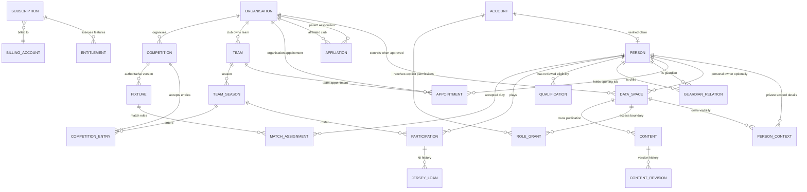

# P01 — Canonical domain and tenancy architecture (proposed)

**Status:** Design candidate for owner review. **Not yet an approved schema, implementation or production migration.**

> **Sequencing agreed 21 October 2026:** P01–P10 will be developed and accepted **within the current GitHub Pages + encrypted coach-workspace application**. Canonical entities here are forward-compatible models and privacy/permission *design*, not a requirement to implement Supabase, individual login or server-enforced tenancy before P10. Backend/provider selection, secure multi-tenant access and real database cutover are explicitly deferred to [post-P10 Issue #55](https://github.com/pdomoney/team-manager/issues/55), and require separate owner approval. Never enable simulated association, club or guardian roles as production security boundaries.  
**Phase:** [#43](https://github.com/pdomoney/team-manager/issues/43) · [Roadmap #41](https://github.com/pdomoney/team-manager/issues/41) · P00 accepted baseline [main `1f9f9301a4ed2c6945d59dea5d3e4ca6316cc641`](https://github.com/pdomoney/team-manager/commit/1f9f9301a4ed2c6945d59dea5d3e4ca6316cc641).  
**Related:** [P00 feature register](p00-baseline-and-preservation.md), [overlap and risk register](p00-data-and-workflow-map.md), [P01 mapping/dry run](p01-schema4-migration-and-dryrun.md), [P01 threat model/platform choice](p01-security-and-platform-options.md).

## 1. Hard separation of concepts

1. **Account** authenticates a particular user. A manually entered Person can exist without any account. An account may be linked to a Person only after a verified invitation/claim process.
2. **Person** identifies an individual within the product after sufficient lawful verification and permission. A person must not be automatically discoverable across unrelated clubs. Existing unlinked records remain provisional scoped person claims until confirmed. A guardian relation is an explicit, restricted relation between two people, not a Helper flag.
3. **Organisation** identifies an association/league or independent club. A club may be affiliated with an association through a mutually authorised relationship. A research directory candidate is *reference data*, not verification or entitlement.
4. **Workspace/DataSpace** defines the **data ownership and isolation boundary**. It may be controlled by an organisation or by an independent individual. A subscription purchaser is not necessarily the owner of each subordinate club's private records.
5. **Subscription/Entitlement** controls purchased capacity and modules; it does not confer access to personal data or organisation administration.
6. **RoleGrant** represents explicit, auditable authorisation within a workspace, organisation, team or competition. **Appointment** describes a sporting/operational job. **Qualification** records eligibility evidence. These three must never be conflated.
7. **Membership/Affiliation** describes association with an organisation, but does not itself confer an ability to read, write or export information.
8. **PlayerParticipation** relates a Person to a specific TeamSeason and holds local playing attributes and the original player-record reference. No automatic overwrites between teams.
9. **Competition** is controlled by an authorised organiser and may have entries from multiple clubs. Fixtures use that organiser's versioned information, with an explicit club-team local override where permitted.
10. **Rules, tactics, plays and content** have separate types, version and owner scope; team copies are independent where previously edited.

## 2. Conceptual relationship diagram

This is **conceptual**, not SQL DDL. The dual guardian and affiliation relationships require explicit source/target FKs, constraints and consent gates in the detailed schema. A person need not have an Account, and a single Account must not become a shortcut for accessing every context where the Person appears.

## 3. Candidate entities and keys

All tenant-owned records require opaque stable IDs, owning data_space_id, created/updated timestamps, actor attribution and explicit lifecycle state. Existing schema-4 IDs are retained via namespaced **LegacyReference**, never re-keyed in place during the first migration. AuditEvent and ConsentRecord are append-only.

| Entity | Minimum fields / invariants | Ownership and future phase |
| --- | --- | --- |
| Account | id, identity-provider subject, verified contact, state, linked person_id nullable, sessions and MFA policy | Identity service; P02 |
| Person | id, claim state (provisional/verified), controlled display identity, retention/consent metadata | Person service, not globally searchable; P04 |
| PersonContext | id, person_id, data_space_id, authorised contact view, sensitive fields separated from public identity | Scoped to owning workspace; P04 |
| Organisation | id, type association/club, branding/profile, verification state, reference link | Organisation owner; P03 |
| OrganisationAffiliation | association_id, club_id, effective dates, status, decision maker and evidence | Both sides approve; P03 |
| DataSpace | id, owner_type organisation/person, owner_id, governance policy and storage region | Explicit tenant boundary; P02/P03 |
| BillingAccount/Subscription/Entitlement | purchaser, plan, status, seats/clubs/modules/limits | Billing/entitlement only; P03 |
| Membership | person_id, organisation_id, type and accepted dates; **no access by itself** | P03/P04 |
| RoleGrant | account_id, data_space_id, scope_type/id, capability set or constrained role, issuer, reason, expiry/revocation | Server-enforced; P02 |
| Appointment | person_id, club/team/association scope, sport context, job, effective dates | Operational role only; P04/P06 |
| GuardianRelation | guardian_person_id, child_person_id, proof/authority/consent, permitted operations, validity | Child privacy; P04 |
| SportRegistration/Qualification | person_id, sport, season, authority/source, qualification, reviewed/expiry date, verification claim level | Does not imply attendance/access; P06 |
| Team | id, club_org_id nullable during migration, sport override/default, name, archived state | P05 |
| TeamSeason | id, team_id, year/dates/state, archival history | P05 |
| Participation | id, team_season_id, person_id nullable while provisional, legacy team_player_id, status, positions, number | No cross-team copies; P05 |
| JerseyLoan | id, participation/team/season reference, number, issued, returned, correction ledger reference | P05 |
| Competition | id, organiser_org_id, sport, edition/format, policy references, status | P07 |
| CompetitionEntry | id, competition_id, team_season_id, division/pool/status, accepted-by | P07 |
| Fixture | id, competition_id nullable for friendlies, version, match date/location, source provenance, status | P07 |
| ScheduledActivity | id, type training/match/task/club event, team/organisation scope, links and owner | P07 |
| MatchAssignment | id, fixture/activity_id, person_id, regulated role, attendance confirmation, evidence snapshot | P06 |
| SportRules/RuleRevision | sport, grade/age, source/edition/checked date, effective period, structured values | P08 |
| Content/Revision/Share | rule/tactic/play/player-set distinctions; data owner, source revision, derived team copy, grants | P08 |
| LegacyReference | import_batch_id, source_workspace, source_path/type/id, new entity id, content hash, review state | Migration P01/P10 |
| ConsentRecord/AuditEvent | purpose, data_space, subject/actor, timestamp, provenance, immutable log metadata | P02/P04/P10 |

**Design constraint:** global identifiers must not become global indexes accessible to ordinary users. No unconsented people lookup by name, date of birth, phone or photo; avoid central storage of WWCC numbers, certificates, IDs or medical files.

## 4. Data authority and permissions matrix

The table describes **intended grants only after P02 implementation**, not capabilities offered by the current prototype. R=read, W=write, A=administer, O=own only, S=summary-aggregate. Every cell is limited to *explicitly authorised scope*, and higher roles do **not** automatically inherit protected child/health/person details.

| Data category | Association officer | Club admin | Coach | Manager | Player | Guardian | Helper |
| --- | --- | --- | --- | --- | --- | --- | --- |
| Association/club public directory | R/W for affiliation admin | R/W own club | R | R | R | R | R |
| Organisation roles and access grants | Delegated A for approved affiliation only | A own club | — | — | — | — | — |
| Team list, sport, fixtures | R relevant clubs | A own clubs | W assigned teams | W assigned teams | R assigned teams | R authorised children teams | R accepted shifts |
| Team roster and player identity | S by default | W own club subject to privacy | W assigned roster | W assigned roster | O / public roster | O for authorised children | No unrelated roster |
| Contacts, injury, safeguarding, child notes | None by default | Minimum necessary, separately granted | Minimum necessary, separately granted | Minimum necessary, separately granted | O | Only expressly granted child fields | O for own contact |
| Qualifications and registration compliance | S by default, no raw documents | Scoped compliance R/W | R eligibility for assigned matches | R assigned staffing | O | O of eligible child's enrolment fields | O |
| Coaching plays and tactics | Only authorised shared library | Club library A | Assigned team W; own private library A | R unless separately granted | R explicitly published | R only approved learning | None |
| Volunteer tasks/assignments | S | Club-wide A | W assigned teams | W assigned teams | O assigned tasks | O assigned tasks/children | O assigned tasks |
| Subscription and billing | A if purchaser | A if purchaser/explicit entitlement manager | A personal purchase only | — | — | — | — |

**Server enforcement:** a valid role label is insufficient. Each request must prove account identity, data_space membership, scope, operation, resource sensitivity, valid invitation/consent and active grant; row-level/security policies must reject guessing IDs, crossing clubs, changing client-side UI and stale sessions. Deny by default. Export and search apply the same checks.

## 5. Hard invariants for owner acceptance

- Association membership or licence purchase **never** gives unrestricted child/staff information or admin powers over a club. Affiliation approval is mutual and revocable.
- A coach may be appointed at multiple unrelated clubs with independent grants and expiry. Removing one club's grant must not remove the other club's relationships, private coaching material or history.
- An organisation-controlled Team may never be moved between data owners just by changing a clubId. Transfers require explicit authorised workflow.
- A Person's team jersey, registration, position, attendance and injury notes are not a universal profile; participation and sensitive records remain context scoped.
- A guardian is a separately verified relation, not a helper, and cannot act for an unrelated child or gain access merely by entering a child's name.
- Match-day yellow/blue/orange shirts and comparable sport classifications represent qualifications and jobs, **not** platform access rights.
- A directory research candidate can link to a managed club only after user confirmation and never assigns official accreditation or club ownership.
- Historic staff names and event/fixture details may be retained as event snapshots, not silently replaced when a Person changes contact details.
- Team, season, player and competition legacy IDs remain resolvable throughout coexistence and rollback.
- No production schema, data, authentication, billing, GitHub publishing, or role controls change in P01.

## 6. Pending owner decisions (not silently decided)

1. **Club visibility for associations:** default to aggregate compliance and directory/fixture records; require additional purpose-specific grant for per-person details.
2. **Person identity governance:** user-held global verified identity with tenant-scoped PersonContext, versus full tenant-local identities linked through a privacy-safe claim. This proposal favours verified shared Person plus context but must not auto-link historical names.
3. **Data region/retention:** preferred Australian hosting and retention requirements for juniors, medical notes, WWCC check evidence and historical club membership.
4. **Club separation within an association-paid subscription:** each club gets its own DataSpace by default; association licensing enables administration and aggregated information, not private-data co-ownership.
5. **Independent coach workspace to club transfer:** personal works remain private unless separately shared/licensed; assignment and deletion policies need approval.
6. **Sources of official fixture and sport-registration data:** only validated agreements/feeds become authoritative; no implied automation.

**Next:** P01 architecture review and synthetic dry run; P02 may build **in-app person/account concepts, role definitions, invitation drafts and simulated permission flows** for trusted users without changing the live shared-password security boundary. **Individual authentication, row-level restrictions, backend authorisation and cross-tenant deployment are post-P10 Issue #55**, only after separate owner approval.
